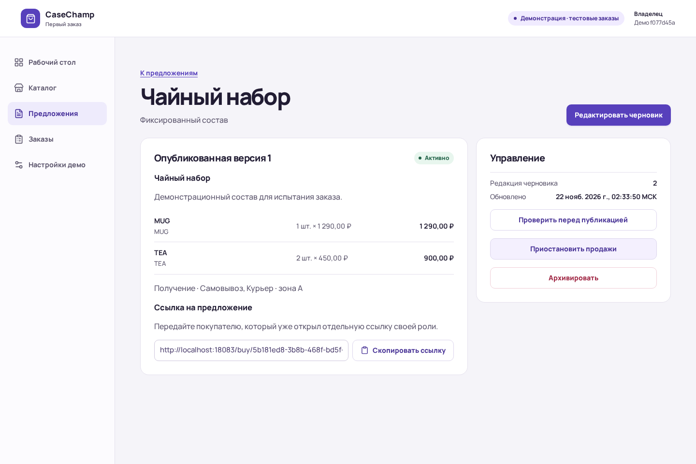

# Case Closed — VK Case Champ

**Команда Case Closed · Санкт-Петербург**

Исследование данных и демонстрационный продукт для решения кейса о развитии торговли во ВКонтакте.

В репозитории находятся две основные части:

- **Аналитика:** исходный датасет, выполненный Jupyter-блокнот, HTML-отчёт, код расчётов, таблицы и графики.
- **Практический проект «Первый заказ из сообщества»:** приложение, которое связывает публикацию товарного предложения, подтверждение покупки и обработку заказа.

## Быстрая навигация

| Что посмотреть | Ссылка |
| --- | --- |
| Полный анализ с кодом, пояснениями и результатами | [Jupyter-блокнот](analysis_uv/VK_full_analysis.ipynb) |
| Аналитический отчёт для чтения без Python | [HTML-версия анализа](analysis_uv/VK_full_analysis.html) |
| Состав исследования и воспроизведение расчётов | [README аналитики](analysis_uv/README.md) |
| Исходный датасет | [case_dataset.xlsx](analysis_uv/source/case_dataset.xlsx) |
| Условие кейса | [case.pdf](analysis_uv/source/case.pdf) |
| Запись работы прототипа | [Демонстрационное видео](casechamp_dev/reports/frontend-v2/core-demo.mp4) |
| Скриншоты и результаты браузерной приёмки | [Отчёт по интерфейсу](casechamp_dev/reports/frontend-v2/README.md) |
| Запуск и сценарии интерфейса | [README клиента](casechamp_dev/apps/web/README.md) |
| Запуск и устройство backend v2 | [Документация backend](casechamp_dev/docs/backend-v2.md) |
| Результаты проверки backend v2 | [Отчёт о приёмке](casechamp_dev/reports/V2.md) |
| Контракт API v2 | [OpenAPI](casechamp_dev/packages/contracts_v2/openapi.json) |

> HTML-отчёт нужно скачать и открыть в браузере. GitHub может показывать его исходный код вместо готовой страницы. Для работы ссылок на дополнительные CSV-таблицы сохраните всю папку `analysis_uv`.

## Идея решения

«Первый заказ из сообщества» помогает продавцу подготовить понятное товарное предложение и провести покупателя до подтверждённого заказа.

Основной сценарий объединяет три роли:

1. **Владелец** выбирает товары, задаёт условия получения, проверяет предложение и публикует его.
2. **Покупатель** открывает предложение, видит состав и полную стоимость покупки, выбирает способ получения, резервирует товары и подтверждает заказ.
3. **Оператор** получает этот же заказ, принимает его в работу и отмечает исполнение.

Владелец и оператор могут быть одним человеком. В демонстрации роли разделены, чтобы показать права доступа и передачу заказа между участниками.

Продуктовая гипотеза: единый путь от предложения до исполнения может упростить запуск продаж и уменьшить потери при согласовании условий покупки. Её коммерческий эффект должен проверяться в контролируемом пилоте.

### Что реализовано в прототипе

- Создание, предпросмотр и публикация товарного предложения.
- Фиксация состава и согласованных условий покупки.
- Расчёт стоимости товаров и получения.
- Резервирование остатков.
- Подтверждение тестового заказа.
- Очередь заказов и обработка оператором.
- Разделение доступа владельца, покупателя и оператора.
- Восстановление результата при повторе подтверждения с тем же ключом запроса.
- Дополнительный сценарий точного подбора комплекта под ограничения покупателя.

### Границы демонстрации

Прототип работает с синтетическими товарами, остатками и тестовыми заказами.

Нативное создание заказа VK, реальная оплата и публикация во внешнее сообщество не подключены. Для продуктового запуска потребуются интеграция с VK и проверка сценария на реальных продавцах.

Дополнительный подбор комплекта в версии 2.0 использует точный алгоритм поиска по заданным ограничениям и приоритетам. Он не требует ML-модели.

## Демонстрация без установки

Начните с [видеозаписи сценария в трёх ролях](casechamp_dev/reports/frontend-v2/core-demo.mp4).

Ниже — реальный экран опубликованного предложения:



Другие этапы:

- [Расчёт стоимости для покупателя](casechamp_dev/reports/frontend-v2/screens/05-quote-360.png).
- [Резервирование товаров](casechamp_dev/reports/frontend-v2/screens/07-reservation-360.png).
- [Созданный заказ](casechamp_dev/reports/frontend-v2/screens/08-buyer-order-360.png).
- [Исполненный заказ у оператора](casechamp_dev/reports/frontend-v2/screens/09-operator-order-768.png).
- [Результат подбора комплекта](casechamp_dev/reports/frontend-v2/screens/10-bundle-solved-1440.png).
- [Состояние, когда подходящий комплект отсутствует](casechamp_dev/reports/frontend-v2/screens/11-bundle-unavailable-1440.png).

Полная галерея и описание проверок находятся в [отчёте по интерфейсу](casechamp_dev/reports/frontend-v2/README.md).

## Аналитическое исследование

Основной файл — [VK_full_analysis.ipynb](analysis_uv/VK_full_analysis.ipynb). Он содержит пояснения, код запуска расчётов, сохранённые результаты, таблицы и графики.

Для чтения без Jupyter предусмотрен [VK_full_analysis.html](analysis_uv/VK_full_analysis.html).

### Что исследовано

- Качество исходных данных: пропуски, дубликаты, противоречия и ограничения полей.
- Состояния каталогов и использование торговых инструментов.
- Сегменты сообществ, их активность и наблюдаемые заказы.
- Связи между контентом, открытиями карточек и заказами.
- Распределение и концентрация показателей.
- Источники открытий карточек, категории товаров и ежедневная динамика.
- Половозрастные и региональные данные.
- Устойчивость выводов при изменении фильтров, порогов и состава выборки.
- Сценарии отбора участников пилота и расчёты его статистической мощности.

Полные результаты сохраняются в CSV и JSON. Для больших таблиц блокнот показывает сокращённый просмотр и ссылку на полный файл.

### Как трактовать результаты

По условию кейса исходные данные синтетические и не отражают реальные показатели VK.

Единица наблюдения в таблице «Бизнесы» — сообщество. Несколько сообществ могут принадлежать одному продавцу.

Отсутствие заказов за наблюдаемый период не означает, что продавец никогда не продавал. Статистическая связь признаков помогает сформулировать гипотезу, но сама по себе не доказывает причину результата.

Методика, ограничения и дополнительные проверки приведены в:

- [Описании исследования](analysis_uv/README.md).
- [Матрице доказательств](analysis_uv/docs/evidence_matrix.md).
- [Проверках устойчивости](analysis_uv/docs/robustness_findings.md).
- [Результатах контрольных проверок](analysis_uv/metadata/validation.json).

## Структура репозитория

| Каталог | Содержимое |
| --- | --- |
| `analysis_uv/` | Самостоятельный проект анализа с окружением uv |
| `analysis_uv/source/` | Исходный датасет и условие кейса |
| `analysis_uv/analysis/` | Python-код, результаты расчётов и аналитические выводы |
| `analysis_uv/analysis/tables/` | Полные таблицы CSV |
| `analysis_uv/charts/` | Графики |
| `analysis_uv/docs/` | Методические пояснения и матрица доказательств |
| `analysis_uv/metadata/` | Сведения об источниках, окружении и выполнении расчётов |
| `casechamp_dev/` | Практический проект |
| `casechamp_dev/apps/web/` | Интерфейс на React и TypeScript |
| `casechamp_dev/services/api/app/v2/` | Backend актуальной версии |
| `casechamp_dev/packages/contracts_v2/` | OpenAPI, схемы и правила API v2 |
| `casechamp_dev/migrations_v2/` | Миграции базы данных v2 |
| `casechamp_dev/fixtures/v2/` | Синтетические данные и контрольные примеры |
| `casechamp_dev/tests/v2/` | Тесты backend v2 |
| `casechamp_dev/reports/` | Сохранённые результаты проверок |
| `casechamp_dev/reports/frontend-v2/` | Скриншоты, видео и браузерная приёмка |

В репозитории сохранены материалы первой версии. Актуальный прототип использует `/api/v2`, `compose.v2.yaml` и `packages/contracts_v2`.

Для запуска версии 2.0 ориентируйтесь на [README клиента](casechamp_dev/apps/web/README.md) и [документацию backend v2](casechamp_dev/docs/backend-v2.md).

## Получение проекта

```bash
git clone https://github.com/galetaa/VK-CHAMP.git
cd VK-CHAMP
```

Аналитика и приложение — отдельные проекты uv со своими зависимостями и lock-файлами. Каждый сценарий ниже начинается из корня репозитория.

## Запуск аналитики

Для работы с анализом нужен uv. Версия Python закреплена в проекте: 3.12.14.

```bash
cd analysis_uv
uv sync --locked
uv run --locked jupyter lab VK_full_analysis.ipynb
```

Чтобы пересчитать блокнот без запуска Jupyter Server:

```bash
uv run --locked python scripts/execute_notebook.py
```

Скрипт выполняет ячейки последовательно и обновляет блокнот и HTML-отчёт.

Подробности окружения и альтернативные режимы выполнения описаны в [README аналитики](analysis_uv/README.md).

## Локальный запуск прототипа v2

### Требования

- Docker с Docker Compose v2.
- Node.js 22.21.1, указанный в [`.node-version`](casechamp_dev/apps/web/.node-version).
- npm 10.9.4.
- uv; в сохранённых инструкциях воспроизведения используется версия 0.13.9.
- Доступ к интернету для первоначальной установки зависимостей и загрузки Docker-образов.

PostgreSQL для демонстрационного приложения запускается в Docker.

Команды ниже предназначены для Bash в Linux, macOS или WSL.

### 1. Установка зависимостей и сборка интерфейса

Из корня репозитория:

```bash
cd casechamp_dev

uv sync --locked

npm --prefix apps/web ci
npm --prefix apps/web run build
```

Сборка интерфейса должна появиться в `apps/web/dist`: этот каталог обслуживает Caddy.

### 2. Создание локального окружения

Выполните один раз из `casechamp_dev`:

```bash
mkdir -p var

uv run --locked python scripts/setup_demo_env.py \
  --output var/compose-v2.env \
  --port 18081
```

Скрипт создаёт локальные учётные данные и секреты. Существующий файл он не перезаписывает. При повторном запуске приложения используйте уже созданный `var/compose-v2.env`.

### 3. Запуск приложения

Из `casechamp_dev`:

```bash
docker compose \
  --env-file var/compose-v2.env \
  -p casechamp-d2-v2 \
  -f compose.yaml \
  -f compose.v2.yaml \
  up -d --build --wait
```

После запуска доступны:

| Назначение | Адрес |
| --- | --- |
| Приложение | http://localhost:18081/ |
| Документация API | http://localhost:18081/api/v2/docs |
| Проверка состояния | http://localhost:18081/api/v2/health |

Файл `compose.v2.yaml` подключается после `compose.yaml`: он выбирает backend и worker актуальной версии.

### Остановка

Из `casechamp_dev`:

```bash
docker compose \
  --env-file var/compose-v2.env \
  -p casechamp-d2-v2 \
  -f compose.yaml \
  -f compose.v2.yaml \
  down
```

Данные в Docker volumes сохраняются.

## Как пройти основной сценарий

Для владельца, покупателя и оператора используйте отдельные профили или независимые контексты браузера: роли связаны с сессионными cookie.

1. Откройте приложение и создайте демонстрацию.
2. В роли владельца создайте предложение с фиксированным составом: `MUG × 1` и `TEA × 2`.
3. Включите самовывоз и курьерскую зону A, проверьте предпросмотр и опубликуйте предложение.
4. В настройках демонстрации создайте одноразовые приглашения покупателю и оператору.
5. Откройте приглашения в отдельных профилях браузера. В профиле покупателя перейдите по ссылке опубликованного предложения.
6. Выберите одну копию предложения и получение курьером. Контрольный расчёт: товары — **2 190 ₽**, получение — **300 ₽**, итог — **2 490 ₽**.
7. Создайте резерв и подтвердите тестовый заказ.
8. В роли оператора найдите заказ, примите его в работу и отметьте исполненным.
9. Вернитесь в профиль покупателя и проверьте обновлённый статус.

Полная инструкция находится в [README клиента](casechamp_dev/apps/web/README.md).

### Дополнительный сценарий подбора

Создайте отдельную демонстрацию с опцией «Добавить демонстрацию подбора» и опубликуйте предложение с шаблоном B001.

Контрольные условия: четыре гостя, своя скатерть, самовывоз и срок один день.

| Бюджет | Ожидаемый результат |
| --- | --- |
| 5 000 ₽ | Комплект на 4 400 ₽ |
| 4 000 ₽ | Комплект на 3 800 ₽ |
| 3 279,99 ₽ | `NO_SOLUTION`: допустимый комплект не найден |

Алгоритм учитывает ограничения и порядок предпочтений. Результат подбора проходит через ту же цепочку расчёта, резервирования и заказа.

## Проверки и доказательства

Сохранённые отчёты позволяют проверить технические результаты демонстрационного стенда.

| Направление | Материалы |
| --- | --- |
| Выполнение аналитического блокнота | [Метаданные выполнения](analysis_uv/metadata/execution.json) |
| Воспроизведение анализа из отдельной копии | [Проверка воспроизводимости](analysis_uv/metadata/distribution_check.json) |
| Проверки числовых итогов и источников | [Validation](analysis_uv/metadata/validation.json) |
| Backend v2 | [Отчёт о приёмке](casechamp_dev/reports/V2.md) · [JUnit](casechamp_dev/reports/v2-pytest.xml) |
| Общая регрессия backend | [JUnit v1 и v2](casechamp_dev/reports/v2-regression.xml) |
| Сетевой проход через Compose | [Результаты smoke-проверки](casechamp_dev/reports/v2-compose-smoke.json) |
| Браузерные сценарии | [Отчёт](casechamp_dev/reports/frontend-v2/README.md) · [Playwright JUnit](casechamp_dev/reports/frontend-v2/playwright.xml) |
| Повтор подтверждения и единый заказ | [Проверенная цепочка заказа](casechamp_dev/reports/frontend-v2/core-order-chain.json) |
| Нагрузочные измерения backend | [Исходные результаты](casechamp_dev/reports/v2-performance.json) |
| Измерения отрисовки интерфейса | [Исходные результаты](casechamp_dev/reports/frontend-v2/render-latency.json) |

В сохранённых результатах аналитики зафиксированы 38 выполненных кодовых ячеек без ошибок. Отчёт backend содержит 43 теста v2, которые входят в общую регрессию из 494 тестов. Для интерфейса сохранены результаты 9 сценариев Playwright; 19 проверок Vitest указаны в отчёте браузерной приёмки.

Часть браузерных проверок использует управляемые часы и контрольные ответы API. Их границы описаны в [отчёте по интерфейсу](casechamp_dev/reports/frontend-v2/README.md).

Коммерческий эффект решения оценивается отдельно в пилоте на реальных заказах.

### Повторный запуск проверок

Из `casechamp_dev`:

```bash
npm --prefix apps/web run typecheck
npm --prefix apps/web test

uv run --locked pytest -q tests/v2

uv run --locked python scripts/smoke_v2.py \
  --origin http://localhost:18081
```

Для backend-тестов с БД нужны локальные бинарники PostgreSQL 17 либо отдельная тестовая база, указанная в `TEST_DATABASE_URL`. Используйте выделенную тестовую БД: без необходимых условий часть проверок может быть пропущена. Подробности — в [документации backend](casechamp_dev/docs/backend-v2.md).

Браузерные проверки выполняются при работающем приложении v2. Из `casechamp_dev/apps/web`:

```bash
npx playwright install --with-deps chromium
npm run test:e2e
```

Для воспроизведения нагрузочных условий дополнительно используется `compose.performance.yaml`. Методика и параметры измерения приведены в [отчёте backend](casechamp_dev/reports/V2.md).

## Технологии

| Часть | Технологии |
| --- | --- |
| Аналитика | Python, Jupyter, uv |
| Интерфейс | React, TypeScript, Vite |
| Backend v2 | Python, FastAPI, Pydantic, SQLAlchemy |
| База данных | PostgreSQL 17 |
| Миграции | Alembic |
| Инфраструктура | Docker Compose, Caddy, фоновый worker |
| Проверки | pytest, Hypothesis, Vitest, Playwright |

## Документация

- [Полное описание аналитики](analysis_uv/README.md).
- [Запуск и сценарии клиента v2](casechamp_dev/apps/web/README.md).
- [Архитектура, запуск и транзакции backend v2](casechamp_dev/docs/backend-v2.md).
- [Контракт API v2](casechamp_dev/packages/contracts_v2/openapi.json).
- [Правила API v2](casechamp_dev/packages/contracts_v2/business_rules.json).
- [Приёмка backend v2](casechamp_dev/reports/V2.md).
- [Приёмка интерфейса, скриншоты и видео](casechamp_dev/reports/frontend-v2/README.md).
